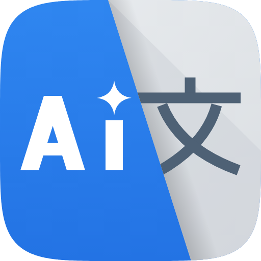

<p align="center">
  
</p>

<h1 align="center">GemTranslate</h1>

<p align="center">
  Полноценный ИИ-переводчик для Android, который живёт внутри Gemini.<br>
  Без своего API-ключа — работает на вашей подписке Gemini.
</p>

---

**English summary.** GemTranslate is a full-featured AI translator (text, voice, conversation mode, camera) that runs as a
Gemini Canvas app, so it uses your own Gemini account and needs no API key. A tiny Android launcher opens the Canvas
behind a splash screen, taps “Open” / “Full screen” / “Allow” for you via an accessibility service, and the result feels
like a native app. Instructions below are in Russian.

---

## Что это

Переводчик сделан как приложение Canvas в Gemini: Gemini сам подставляет доступ к своей модели, поэтому ключ API не нужен.
Чтобы это не выглядело как «открой чат → нажми „Открыть“ → разверни → разреши микрофон», есть маленький APK-ярлык:
нажимаете иконку — видите заставку — через пару секунд перед вами готовый переводчик.

**Возможности переводчика**

- Перевод текста по мере набора, 90+ языков и любой «свой» язык, автоопределение языка.
- Голосовой ввод: тап — говорите сколько угодно с паузами, тап — перевод. Или удерживайте кнопку, как рацию.
- «Возможно, вы имели в виду…», если что-то расслышано неверно.
- **Режим диалога** в стиле переписки: у каждого собеседника свой микрофон, перевод озвучивается автоматически,
  сообщения можно редактировать и удалять долгим нажатием.
- **Камера**: перевод накладывается прямо на фото вывески или меню.
- Режимы: быстрый, разговорный, деловой, дословный и «Передать суть» — смысл важнее дословности.
- Озвучка голосом Gemini, медленная озвучка, варианты перевода, история с поиском и избранным.
- Интерфейс сам переводится на язык телефона.

**Как устроен запуск**

```
Иконка «Переводчик» → заставка поверх экрана
  └─ под заставкой: чат Gemini → «Открыть» → «Во весь экран» → «Разрешить» (микрофон и камера)
→ заставка исчезает → переводчик готов
```

## Что понадобится

- Телефон на Android 8 или новее с приложением **Gemini** и аккаунтом Google, в котором доступен Canvas.
- 10–15 минут на настройку.
- По желанию — компьютер (Windows или Mac) на 5 минут: один раз выдать разрешение через ADB.
  Тогда служба ярлыка включается только на время запуска, и банковские приложения не ругаются (см. шаг 5).

---

## Шаг 1. Создайте переводчик в Gemini (Canvas)

1. Скачайте файл переводчика: [`dist/translator-canvas.html`](dist/translator-canvas.html) (кнопка «Download raw file»).
   Если ваш телефон не даёт прикрепить `.html`, переименуйте файл в `translator-canvas.txt`.
2. Откройте Gemini (приложение или [gemini.google.com](https://gemini.google.com)), начните **новый чат**.
3. Прикрепите файл и напишите:

   > Сделай Canvas приложение из этого файла, ничего не меняя и не сокращая.

4. Откройте получившийся Canvas и проверьте: введите текст — должен появиться перевод; нажмите микрофон и разрешите доступ.

> **Важно: загружайте именно `translator-canvas.html`, а не `index.html`.**
> Gemini не копирует файл, а заново «переписывает» его своей моделью. Полная версия (`index.html`, ~96 тыс. токенов)
> в один ответ не помещается, и Gemini молча выкидывает куски кода. Компактная версия (~48 тыс. токенов) помещается целиком.
> Проверить, что всё перенеслось: во вкладке «Код» Canvas должен находиться текст `perm-warmup`.

## Шаг 2. Скопируйте ссылку на этот чат

Откройте тот же чат на [gemini.google.com](https://gemini.google.com) **в браузере** и скопируйте адрес страницы —
он выглядит как `https://gemini.google.com/app/…`. Перешлите его себе на телефон (заметки, мессенджер).

## Шаг 3. Установите ярлык

1. Откройте [Releases](../../releases/latest) и скачайте на телефоне `Translator.apk` из последней сборки.
2. Откройте файл и разрешите установку из этого источника, если система спросит.

## Шаг 4. Первый запуск

Откроется экран настроек (позже он доступен долгим нажатием на иконку → «Настройки»).

1. **Ссылка на чат** — вставьте ссылку из шага 2.
2. **Автонажатие** — включите службу «Переводчик: автооткрытие»:
   «Открыть „Специальные возможности“» → «Установленные приложения» → «Переводчик: автооткрытие» → включить.
   - Если переключатель серый («Запрещённые настройки»): «Открыть сведения о приложении» → ⋮ вверху справа →
     «Разрешить запрещённые настройки», затем включите службу снова.
   - Если вы сделаете шаг 5, этот пункт можно пропустить — служба будет включаться сама.
3. «Сохранить и открыть переводчик».

Готово: нажмите иконку — заставка, и через пару секунд вы в переводчике.

## Шаг 5 (рекомендуется). Служба только на время запуска

Некоторые приложения (банки, платёжные) отказываются работать, пока на телефоне включена сторонняя служба
«Специальных возможностей». Решение: один раз выдать ярлыку разрешение через ADB — тогда он сам включает службу
при нажатии на иконку и выключает её, как только переводчик открылся.

**На телефоне**

1. «Настройки» → «Сведения о телефоне» → «Сведения о ПО» → 7 раз нажмите «Номер сборки»
   (на других телефонах пункт может называться немного иначе) — появятся «Параметры разработчика».
2. «Настройки» → «Параметры разработчика» → включите «Отладка по USB».

**На компьютере с Windows**

1. Скачайте официальные инструменты Google:
   [platform-tools для Windows](https://dl.google.com/android/repository/platform-tools-latest-windows.zip).
2. Распакуйте архив в `C:\` — получится папка `C:\platform-tools`.
3. Откройте эту папку в Проводнике, кликните в адресную строку, впишите `cmd` и нажмите Enter.
4. Подключите телефон кабелем и введите `adb devices`. На телефоне разрешите отладку
   («Всегда разрешать с этого компьютера»). Повторите `adb devices` — должна появиться строка с `device`.
5. Введите команду (её же можно скопировать в настройках ярлыка):

   ```
   adb shell pm grant app.aitranslator.launcher android.permission.WRITE_SECURE_SETTINGS
   ```

   Если команда ничего не ответила — всё получилось.

**На Mac** — то же самое: [platform-tools для Mac](https://dl.google.com/android/repository/platform-tools-latest-darwin.zip),
распаковать, открыть «Терминал» в этой папке и вводить команды с `./` в начале: `./adb devices`, `./adb shell pm grant …`.

**Проверка.** В настройках ярлыка должно быть «✓ Разрешение выдано». Если службу раньше включали вручную —
выключите её в «Специальных возможностях», дальше она включается сама. Отладку по USB после этого можно выключить.

Разрешение сохраняется, пока приложение установлено. Обновления ставьте поверх — без удаления, и ничего повторять не придётся.

---

## Если что-то не работает

| Что происходит | Что делать |
|---|---|
| Заставка исчезла, а Canvas не открылся или не развернулся | Долгое нажатие на иконку → «Настройки» → «Последний запуск»: там видно, на каком шаге остановилось и какие кнопки служба видела. Если Gemini переименовал кнопку — впишите новую подпись в поле «Подписи кнопок». |
| «Нет доступа к API (401…)» | Пересоздайте Canvas из `translator-canvas.html` (шаг 1). Обычно это сбой конкретной сборки Canvas в Gemini. |
| Нет новых функций / что-то пропало | Gemini обрезал файл при создании Canvas. Загрузите `translator-canvas.html` заново и проверьте `perm-warmup` во вкладке «Код». |
| Банк или другое приложение ругается на «Специальные возможности» | Сделайте шаг 5. |
| Новая версия APK не ставится поверх | Удалите старую и установите новую (тогда шаг 5 нужно повторить). |
| Каждый запуск Gemini снова спрашивает микрофон | Так устроен Gemini, ярлык сам нажимает «Разрешить». Если не нажимает — смотрите «Последний запуск». |

## Безопасность и приватность

- Служба «Специальных возможностей» видит **только** приложения Gemini и Google и работает лишь ~20 секунд после
  нажатия на иконку ярлыка. Когда вы открываете Gemini сами, она ничего не нажимает. С разрешением из шага 5 она
  в остальное время вообще выключена.
- Ярлык ничего никуда не отправляет и не собирает: он хранит только ссылку на ваш чат и подписи кнопок.
- Переводы обрабатывает Gemini в вашем аккаунте, как любые запросы в чате. Настройки и история переводчика хранятся
  на телефоне и (если Canvas это поддерживает) в хранилище Canvas вашего аккаунта.

---

## Для разработчиков

```
index.html                 — переводчик целиком (HTML + Tailwind + JS), основная версия с комментариями
dist/translator-canvas.html — компактная сборка для Canvas (без комментариев, Tailwind с CDN)
tools/                      — сборка встроенных стилей и компактной версии
android/                    — ярлык: LaunchActivity, AutoClickService (нажатия + заставка), SetupActivity
.github/workflows/          — сборка APK в GitHub Actions и публикация в Releases
```

- После правок `index.html`: `cd tools && npm install && npm run css && npm run canvas`.
- APK собирается автоматически при изменениях в `android/`. Без настроенных секретов каждая сборка подписывается новым
  ключом (обновление — только через удаление). Чтобы обновления ставились поверх, добавьте в
  Settings → Secrets and variables → Actions свои `LAUNCHER_KEYSTORE_B64` (ключ .jks в base64) и
  `LAUNCHER_STORE_PASSWORD` (пароль, алиас ключа — `launcher`). Подробнее — [android/README.md](android/README.md).

## Лицензия

[GNU AGPL-3.0](LICENSE).
